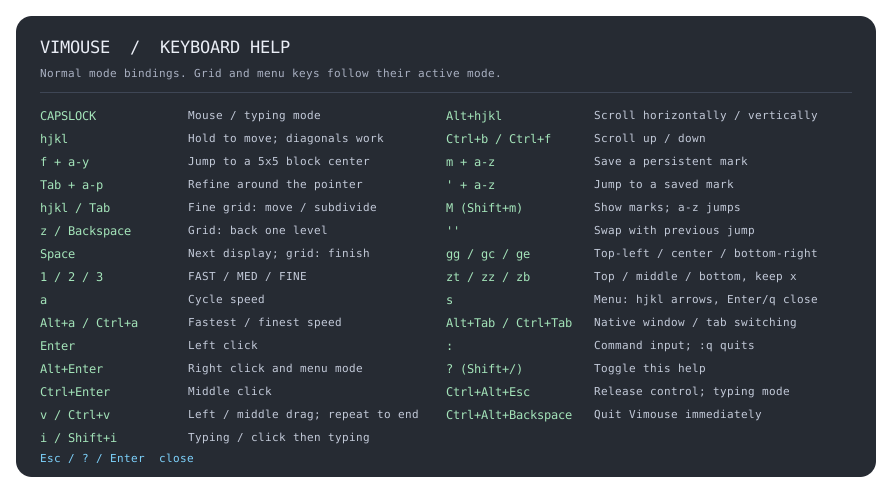

# Vimouse

用 Vim 的方式操作鼠标：`hjkl` 移动，`f` 快速跳转，`Tab` 精细定位。按一次 `Caps Lock` 开始控制，再按一次回到正常打字。

Vimouse 是面向 Linux 的 Rust 项目。浮层直接使用 Wayland，字体内嵌，无需 Qt 或 GTK；musl 构建可作为单个静态二进制运行。原 Python / Windows 版本已归档至 [vimouse-legacy](https://github.com/Yunus4832/vimouse-legacy)。

日常控制时只显示右下角的模式与速度胶囊，输入命令时展开命令条；打字时隐藏。浮层始终允许鼠标点击穿透，不接收键盘焦点。


## 支持环境

完整体验需要 **Linux + 支持 layer-shell 的 Wayland 桌面**，主要面向 KDE Plasma Wayland 和 niri。当前静态构建目标为 x86_64。

- 需要键盘设备与 `/dev/uinput` 的访问权限，使用 `vimouse init` 一次性配置。
- GNOME Wayland、X11 暂无浮层后端，可尝试 `--no-hud` 输入控制，无法使用完整网格界面。
- Windows、macOS 暂不支持。其他 Wayland 合成器的兼容情况见[支持范围与限制](docs/guide.md#010-支持环境与限制)。

## 安装与启动

目前可以从源码构建，需要 Linux 和 Rust 工具链：

```sh
git clone https://github.com/Yunus4832/vimouse.git
cd vimouse
cargo build --release --locked

./target/release/vimouse init
./target/release/vimouse doctor
./target/release/vimouse run
```

请在**桌面终端中以普通用户**执行。`init` 会按需通过 sudo 或 pkexec 请求管理员认证，配置 uinput 和设备权限；日常运行无需 sudo。当前设备权限立即生效，建议注销并重新登录一次，让用户组权限覆盖后续设备与服务。

想先看看效果，可运行 `cargo run -- demo`，输入 `caps f a` 并回车。演示不接管键盘，也不移动系统鼠标。

试用满意后，可安装为登录自启动的用户服务。先退出前台运行的实例，再执行：

```sh
./target/release/vimouse install-service
~/.local/bin/vimouse start
```

`install-service` 会将程序复制到 `~/.local/bin/vimouse` 并启用自启动，`start` 立即启动服务。若只想安装程序、仍手动运行，使用 `vimouse install`。详情见[安装与设备权限](docs/guide.md#安装与设备权限)。

## 开始使用

程序启动于 **Insert（打字）模式**。按 `Caps Lock` 进入 **Normal（鼠标控制）模式**，常用操作如下；按 `?` 可随时打开帮助。

| 按键 | 操作 |
| --- | --- |
| `h` / `j` / `k` / `l` | 按住向左 / 下 / 上 / 右移动 |
| `1` / `2` / `3` | 切换快 / 中 / 慢三档速度 |
| `Enter` | 左键点击 |
| `Alt+Enter` | 右键点击，进入菜单选择模式 |
| `Ctrl+Enter` | 中键点击 |
| `v` | 开始左键拖选，再按一次结束 |
| `Alt+hjkl` | 水平或垂直滚动 |
| `Space` | 切换到下一块显示器并居中 |
| `i` 或 `Caps Lock` | 回到打字模式 |

**紧急释放：`Ctrl+Alt+Esc` 返回打字模式；`Ctrl+Alt+Backspace` 退出程序。**

### 快速跳转与精细定位

`f` 和 `Tab` 是两个独立工具，可以单独使用，也可以接着用：

1. 按 `f`，当前显示器出现 **5×5 字母网格**。按目标区域的字母，鼠标跳到该格中心，立即回到 Normal。
2. 接着可以直接用 `hjkl` 移动；需要精调时按 `Tab`，以当前鼠标位置为中心展开 **4×4 网格**。
3. 选中字母后进入 **3×3 微调**，用 `hjkl` 选格；再按 `Tab` 可细分到最后的 **2×2**。
4. 按 `Space` 完成定位，或按 `Enter` 完成并点击。`z` / Backspace 返回上一层，`Esc` 取消并恢复进入工具时的位置。

网格字母位于鼠标落点中心；细分到 3×3、2×2 后不再显示字母。完整规则与示例见[网格操作](docs/guide.md#f-快速选块)。

### 保存常用位置

- `m` 后接 `a`–`z`：保存当前位置。
- `'` 后接对应字母：跳转到已保存位置。
- `M`（Shift+m）：在各显示器上展示标记，按字母跳转；Esc 收起。
- `''`：与上次跳转的位置交换。

命名标记会自动保存，重启后恢复。坐标按显示器名称与屏内相对位置记录，分辨率、缩放或排列变化后仍可使用；离线显示器的标记保留。详情见[mark 持久保存](docs/guide.md#mark-持久保存)。

更多操作包括菜单选择、命令输入、窗口切换与跳转，见[完整按键表](docs/guide.md#操作)，或在 Normal 中按 `?`：



## 服务管理与更新

以下命令假设 `~/.local/bin` 已加入 PATH；否则请使用完整路径 `~/.local/bin/vimouse`。

```sh
vimouse status
vimouse stop
vimouse start
journalctl --user -u vimouse.service -n 40
```

更新源码后，重新构建并替换已安装的程序，再重启服务：

```sh
git pull --ff-only
cargo build --release --locked
./target/release/vimouse install
~/.local/bin/vimouse stop
~/.local/bin/vimouse start
```

更新保留配置与标记。服务与前台 `run` 选择一种运行方式即可，详情见[用户服务](docs/guide.md#安装用户服务与自启动)。

## 配置与文档

无需配置即可运行。需要调整速度、切换键或空闲超时，可复制示例后修改，重启生效：

```sh
mkdir -p ~/.config/vimouse
cp config.example.toml ~/.config/vimouse/config.toml
```

- [使用与开发指南](docs/guide.md)：完整按键、权限、标记格式、多屏、兼容性与静态构建。
- [架构与实机检查](docs/architecture.md)：代码结构和验证方法。
- [更新记录](CHANGELOG.md) · [后续快捷键候选](docs/shortcuts-roadmap.md)。

许可证为 [Apache-2.0](LICENSE)，来源与第三方说明见 [NOTICE](NOTICE)。单文件发行包内也可使用 `vimouse licenses` 查看。
